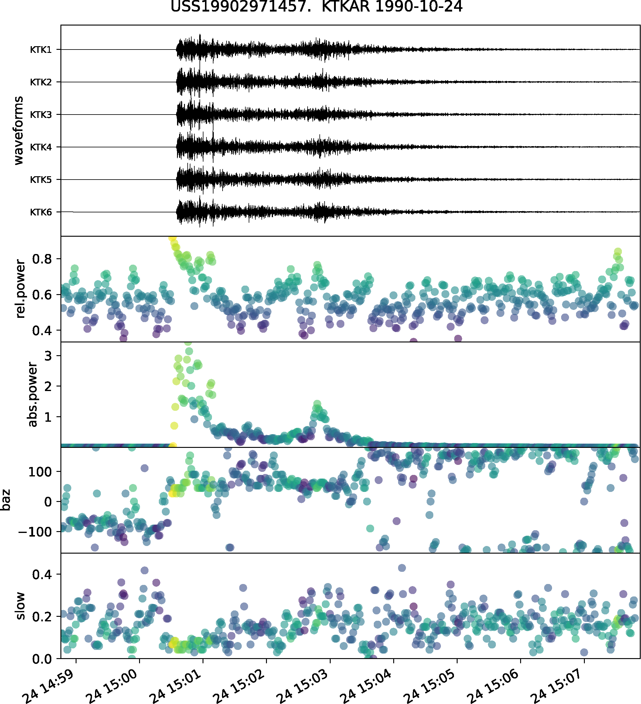
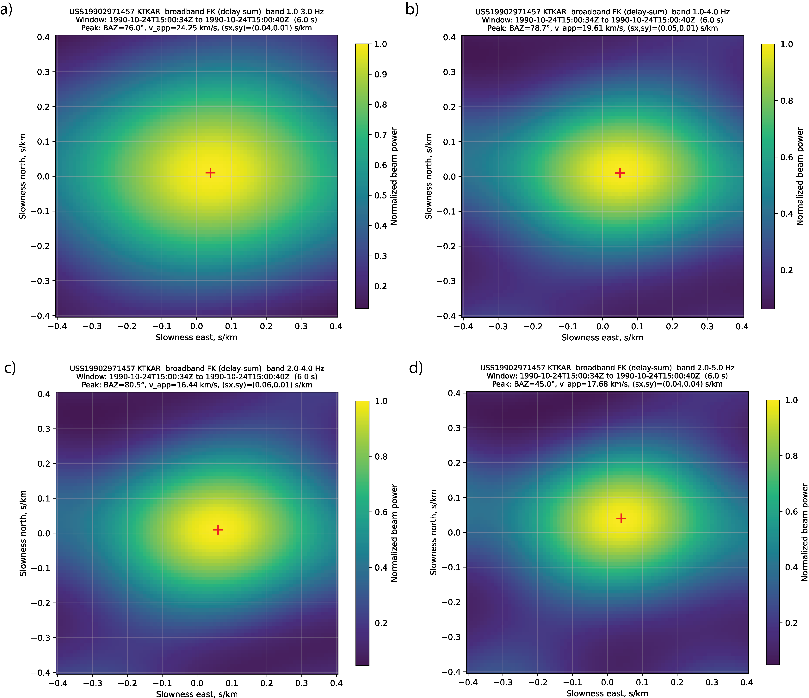

Folder *array_processing_examples*  

Just a few python scripts to exploit and display signal properties obtained using array processing.  

For example, the script **USS19902971457_KTKAR_test_wfplot.py** reads in waveforms for the Kautokeino array
for the October 24, 1990, Soviet nuclear test on Novaya Zemlya. It generates four panels showing
signal propagation parameters slowness (in seconds per km), backazimuth (in degrees from North),
the absolute power and the relative power.  

The script **USS19902971457_KTKAR_fk_broadband.py** performs broadband frequency-wavenumber analysis on a time
window encompassing the Pn arrival at KTKAR from the same event. The analysis is performed in four different 
frequency bands. We see that the resolution in slowness is
rather limited and that the apparent velocity indicated is rather higher than would be expected for a regional
Pn arrival. The direction resolution is limited but consistent with an event from Novaya Zemlya.  

