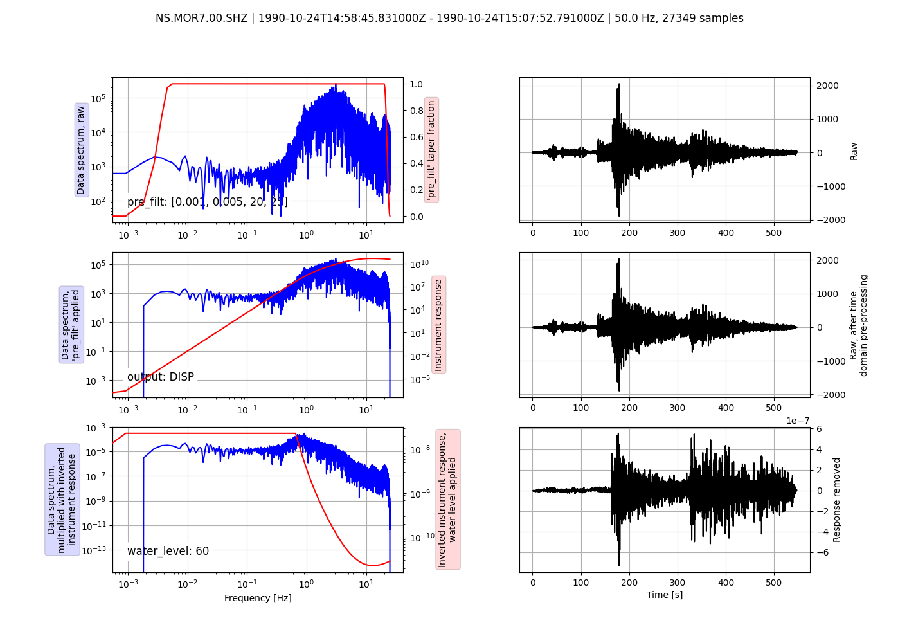
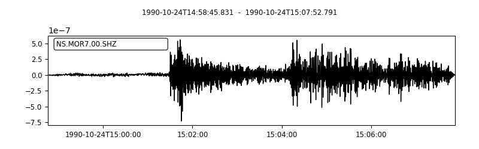

Folder *remove_response_example* containing a bash script that generates a
displacement trace with the instrument response removed.  

```
sh ./resp_remove_one_file.sh  USS19902971457/USS19902971457_NS.MOR7.00.SHZ.mseed  RESPONSES/MOR7.xml
```

You will probably have to adjust the paths in the script to make it find the location you have saved the waveforms and responses.






